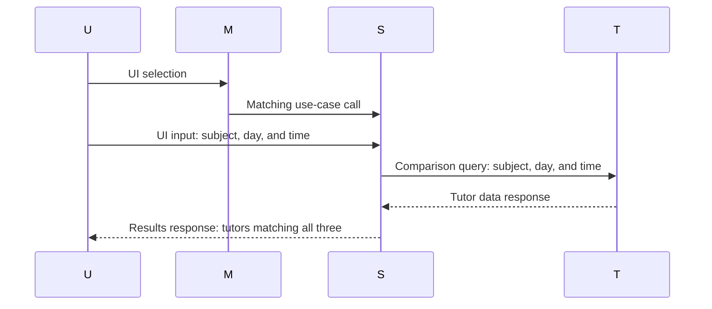

Use case: Find tutors by subject and schedule

Actor: User

Goal: Find a tutor who matches a requested subject, day, and time.

Precondition: A list of tutors with subjects, days, and times exists.

Main success scenario:

The user selects subject-and-schedule matching from the main menu. The user enters a subject, day, and time. 
The system compares the entered subject, day, and time with the tutor list. The system displays tutors who match all three entries.

Extensions:

2a. The user does not enter a subject, day, or time. The comparison does not proceed. 
3a. No tutor matches the entered subject. The system returns no tutors.
3b. Tutors match the subject but not the entered day. The system returns no tutors. 
3c. Tutors match the subject and day but not the entered time. The system returns no tutors.

  flowchart LR
    U[User]
    M[Main menu]
    S[System]
    T[Tutor list]

    U -->|UI selection| M
    M -->|Matching use-case call| S
    U -->|UI input: subject, day, and time| S
    U -->|UI input: missing subject, day, or time| S
    S -->|Comparison query: subject, day, and time| T
    T -->|Tutor data response| S
    S -->|Results response: tutors matching all three| U
    S -->|Validation response: comparison does not proceed| U
    S -->|Empty result: no subject match| U
    S -->|Empty result: subject matches, day does not| U
    S -->|Empty result: subject and day match, time does not| U

Gap: The table provides descriptions such as “Matching use-case call” and “Comparison query,” but it does not provide actual function or method names for the arrows.

    
